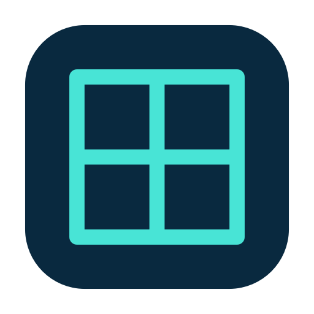

<p align="center">
  
</p>

<h1 align="center">Lattice</h1>

<p align="center">
  <strong>My personal, opinionated take on <a href="https://github.com/vorssaint/vorssaint-utils">Vorssaint</a> — crafted for better Mac ergonomics.</strong><br>
  One tidy menu bar app replacing a dozen paid utilities.<br>
  Fast, private, and tailored for daily flow.
</p>

<p align="center">
  <a href="#about-lattice">About</a> ·
  <a href="#features">Features</a> ·
  <a href="#install">Install</a> ·
  <a href="#private-by-default">Privacy</a> ·
  <a href="docs/LATTICE.md">Downstream Specs</a> ·
  <a href="#upstream--acknowledgements">Upstream & Acknowledgements</a>
</p>

<p align="center">
  <a href="https://github.com/sam32j/lattice/tree/lattice/main"></a>
  <a href="#what-you-need"></a>
  <a href="LICENSE"></a>
  <a href="https://github.com/vorssaint/vorssaint-utils"></a>
</p>

Per app volume, a real system monitor, a better app switcher, window snapping, Dock previews, clipboard history, text snippets, a file shelf, an uninstaller. The utilities Mac users usually buy one by one, together behind a single menu bar icon, with no account, no telemetry and no subscription.

> [!IMPORTANT]
> **First launch: Lattice is not notarized by Apple.** macOS may block it because Apple cannot verify the developer or check the app for malicious software. Only proceed if you trust the download. After copying Lattice to Applications and trying to open it, go to **System Settings > Privacy & Security > Open Anyway**. See the [first-launch guide](TROUBLESHOOTING.md) for details and an app-specific quarantine workaround. The guide is also included in the DMG.

## About Lattice

Hey! I’m [Samuel](https://github.com/sam32j). **Lattice** is my daily-driver Mac utility app—an opinionated, personal fork of the wonderful [Vorssaint](https://github.com/vorssaint/vorssaint-utils).

I love Vorssaint's all-in-one philosophy, but I wanted something tailored to my own workflow that feels more natural, responsive, and ergonomic:

- **Crafted for flow:** Streamlined screen capture & recording, compact single-row shortcut setters, and native macOS settings that stay out of your way.
- **Thoughtful ergonomics:** Tiny interaction polish everywhere—instant pinch-zoom on pinned captures, smart window selection, and faster keyboard preview actions.
- **Best of both worlds:** Automatically stays synced with upstream Vorssaint releases while keeping these ergonomic refinements intact.

If you appreciate a tidy, cohesive Mac setup that feels effortless every day, you might enjoy using it too.

---

## Features

### Media Optimizer

Optimize JPEG, PNG, HEIC, animated GIFs and macOS-compatible videos in
**Utilities > Media Optimizer**. No Clop app, FFmpeg or Homebrew installation is
needed. JPEG/HEIC and video use Apple's native engines; small bundled PNG/GIF
tools are built from pinned source with licenses and source included in the app.
Videos export as HEVC MP4 up to 1080p, or 720p with stronger compression.
The quick-action format bar also offers H.264 MP4 for wider compatibility,
and JPEG, PNG or HEIC conversion for still images. GIFs remain animated GIFs.
Input compatibility depends on the codec, not just the extension; MKV/WebM are
not guaranteed. Lattice processes copies and keeps your originals. If encoding
does not reduce the size, it saves an original-quality copy instead.
Explicit format conversion honors your selection even if the result is larger.

The compact optimizer HUD offers progress, size savings, original preview and
Copy, Reveal and drag-out actions. Choose a standalone window or Dynamic Island
in Media Optimizer settings; the island presentation requires its Files widget.
When File Cache and the optimizer both use standalone windows, drag and shake
as usual, then hold Option to switch the same window to optimization. Release
Option before dropping to return to File Cache; dropping keeps the optimizer
result open. This does not change keyboard shortcuts. Quick drops save copies
beside their originals, asking for a folder if needed. Clipboard access is
explicit through Copy; the optimizer does not monitor your clipboard.
The former converter, GIF maker and media text-extraction workspace are removed.

Lattice inherits the full suite of 50+ built-in Mac utilities from Vorssaint—including per-app volume, system monitor, window snapping, clipboard history, app uninstaller, and much more.

👉 **Check out the full feature catalog on [Vorssaint](https://github.com/vorssaint/vorssaint-utils#everything-it-does).**

## Install

### Build from source

```sh
git clone https://github.com/sam32j/lattice.git
cd lattice
./build.sh --dev            # build the separate Developer variant
./build.sh --dev --install  # install and launch it
```

Xcode Command Line Tools are the only requirement.

### Releases

Lattice releases use the `vX.Y.Z-d.N` scheme. Look for downloads on [GitHub Releases](https://github.com/sam32j/lattice/releases). Current Lattice builds are not Apple-notarized; read the [first-launch guide](TROUBLESHOOTING.md) before opening a downloaded build.

> [!NOTE]
> If you are looking for official upstream builds of Vorssaint with maintainer Developer ID signatures, install upstream via Homebrew (`brew install --cask vorssaint`) or download from [vorssaint/vorssaint-utils](https://github.com/vorssaint/vorssaint-utils/releases).

## Uninstall

To remove Lattice completely, including its isolated settings, data, and helper permissions:

```sh
./Tools/uninstall.sh
```

## Private by default

Lattice is local-first, with no account, analytics or tracking. Core utilities run on your Mac, and settings and clipboard history stay there. Some features use the network, including update checks, the speed test, Homebrew actions, optional lyrics and artwork lookups, AI price and account-limit checks, AirPlay on your local network, temporary capture links and feedback you explicitly send. See the [privacy notes](docs/PRIVACY.md) for the data and controls involved. Local-first does not mean entirely offline or a guarantee of safety.

Permissions get the same treatment. Every one is optional, the app explains each in plain words, shows which features actually use it, and even tells you when a permission you granted is no longer needed by anything, with a shortcut to revoke it. See the [permissions guide](docs/PERMISSIONS.md) for which features need access and what remains available without it.

## What you need

- A Mac with Apple Silicon
- macOS 14 Sonoma or newer
- Xcode Command Line Tools (for building from source)

## When something misbehaves

See [troubleshooting](docs/TROUBLESHOOTING.md) for launch problems, permissions and missing previews, or upstream [support](SUPPORT.md) for help.

## Documentation

- [Lattice Downstream Specs](docs/LATTICE.md), architecture, versioning and sync workflow
- [Privacy](docs/PRIVACY.md), what does and does not leave your Mac
- [Permissions](docs/PERMISSIONS.md), every macOS permission in plain words
- [Troubleshooting](docs/TROUBLESHOOTING.md), the common fixes
- [Contributing](CONTRIBUTING.md), build, layout and conventions
- [Security](SECURITY.md), how to report a vulnerability

## Upstream & Acknowledgements

Lattice is built upon the exceptional work of the open-source upstream project [Vorssaint](https://github.com/vorssaint/vorssaint-utils). Full attribution and gratitude go to:

- **[Vorssaint](https://github.com/vorssaint/vorssaint-utils)** — created and maintained by [@vorssaint](https://github.com/vorssaint) ([vorssaint.com](https://vorssaint.com)).
- **Original App Icon** — designed by [@divisionseven](https://github.com/divisionseven) for Vorssaint.
- **The Upstream Contributors** — the open-source community that created and tested these capabilities.

If you enjoy this software, please support the upstream project:
- ⭐️ Star the upstream repository: [vorssaint/vorssaint-utils](https://github.com/vorssaint/vorssaint-utils)
- ☕️ Support the upstream maintainer: [Buy Me a Coffee](https://buymeacoffee.com/vorssaint)
- 💬 Join the upstream [Discord](https://discord.gg/M6BwWH4BJp)

## License

[GPL 3.0 or later](LICENSE), Copyright (C) 2026 Vorssaint and contributors. Downstream modifications and branding Copyright (C) 2026 Samuel Ji.

Per [TRADEMARKS.md](TRADEMARKS.md), this fork uses independent branding ("Lattice"), custom icon artwork, and isolated bundle identifiers (`io.github.sam32j.lattice`) to avoid confusion with official upstream releases.
